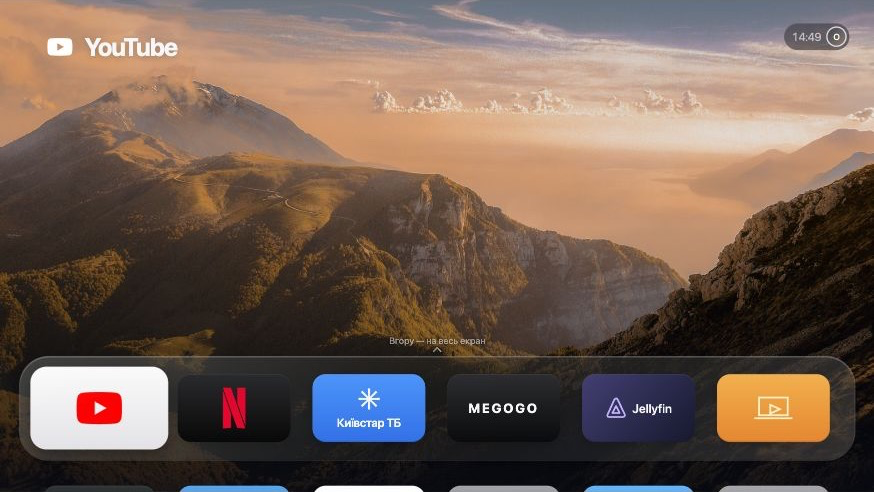
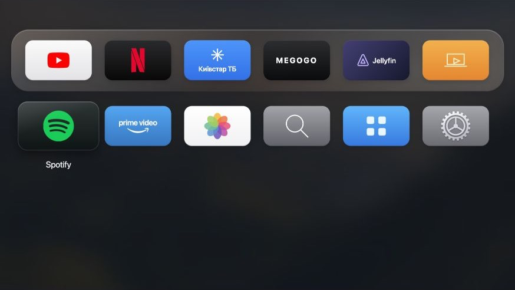
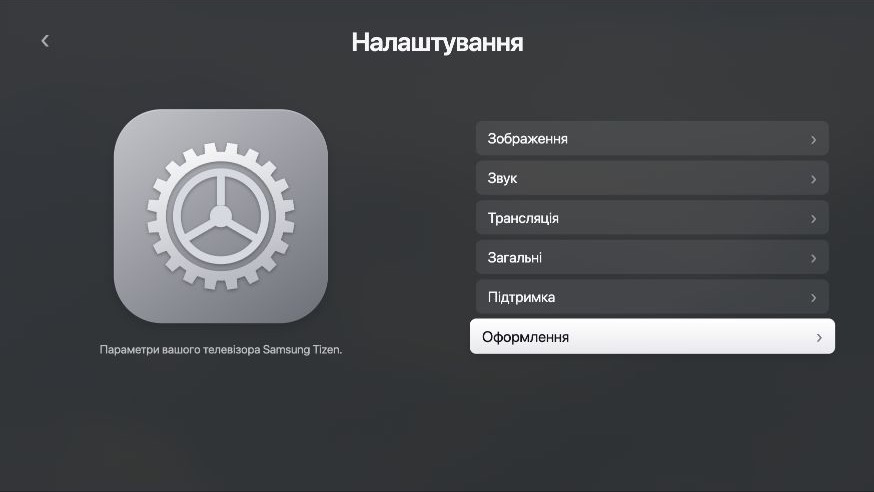

# GlassHome

**A familiar home screen. Your existing apps. Samsung Tizen underneath.**

GlassHome is a custom home-screen prototype for Samsung Tizen TVs, using the Apple TV user guide as its visual reference. It explores a cleaner launcher while keeping your installed apps and their native interfaces.

**Current status: browser prototype.** No TV installation, root access, debloating or device backup has been performed. TV integration is a separate, future stage; the current app cannot change your TV.



[Try locally](#run-the-preview) · [Controls](#controls) · [TV status](docs/STATUS.md) · [Native-menu research](docs/research/Q77A-2301-MENUS.uk.md) · [Backup and recovery](docs/RECOVERY.md) · [Design references](docs/DESIGN-REFERENCES.md)

## What works today

- A shared glass-style Dock with a six-column app grid and an enlarged focus state.
- A five-column layout when large items are selected.
- Top Shelf-style background preview, full-screen preview and a scrolling transition to the app grid.
- Remote-style arrow navigation, Enter to select and Escape to go back.
- App rearrangement: hold Enter, move with the arrows, then save or cancel.
- A Home editor that hides demo shortcuts without uninstalling anything.
- Separate settings pages with Samsung/Tizen categories and an Apple TV-inspired composition.
- Light, dark and automatic appearance; wallpaper, layout and shortcut preferences saved in the browser.

The app list is illustrative. The scenic background is a preview asset, not recommendations or watch history retrieved from YouTube, Netflix or another installed app. Device actions show their unavailable state instead of reporting simulated success.

### App grid



### Settings



## Run the preview

Use **Node.js 22 or later**. The project has no npm dependencies and does not require an install step.

```sh
git clone https://github.com/zdebskyy/glasshome-tizen.git
cd glasshome-tizen
npm run dev
```

Open **[localhost:4797](http://127.0.0.1:4797/)**. The server binds only to `127.0.0.1`; it does not contact or discover a TV.

To use another port:

```sh
PORT=4800 npm run dev
```

You can also open `app/index.html` directly. Browser storage behavior can differ for local files, so the local server is recommended for previewing saved preferences.

## Controls

| Input                                                   | Action                                              |
| ------------------------------------------------------- | --------------------------------------------------- |
| Arrow keys                                              | Move focus                                          |
| Enter                                                   | Select the focused item                             |
| Escape / Backspace                                      | Go back or cancel                                   |
| Click outside Control Center, its top toggle, or Escape | Close Control Center and return focus to its opener |
| Up on a supported top-row tile                          | Expand the sample background preview                |
| Down / Escape in full-screen preview                    | Return to Home                                      |
| Hold Enter on an app, or right-click it                 | Start rearranging                                   |
| Arrows while rearranging                                | Move the picked-up app                              |
| Enter while rearranging                                 | Save the order                                      |
| Escape while rearranging                                | Cancel and restore the original order               |

Mouse clicks work too. The toolbar below the TV canvas switches between Home, the app grid and Settings. These are preview controls, not part of the intended TV interface.

## Design reference

The layout follows official Apple illustrations for Home, focus, appearance settings and Control Center. An additional Apple Developer screenshot informs the settings-page composition. The default scene is 1920 × 1080 and scales uniformly to fit the browser.

This is an adaptation, not a pixel-perfect reproduction of every tvOS state. It uses Samsung-oriented menu labels, demo service icons and different artwork. CSS approximates glass highlights and depth; it does not reproduce Apple's native Liquid Glass renderer. Font rendering also depends on the host system.

See [the reference register](docs/DESIGN-REFERENCES.md) for exact sources, implementation choices and known differences. [The original Ukrainian notes](docs/DESIGN-REFERENCES.uk.md) are preserved as well.

## TV compatibility and integration

The intended first target is a **Samsung QE55Q77AATXXH**, with firmware **T-NKM2DEUC-2301.1** recorded from the owner's photo and confirmed current by the owner. Live capabilities and installation compatibility have not been checked. Browser success does not establish Tizen compatibility.

Further menu and control changes are on hold pending verification of the target TV's native menus. [Documentary research](docs/research/Q77A-2301-MENUS.uk.md) records 208 candidate paths from Samsung's linked family manual, with source pages and availability caveats. They are not a verified live tree for firmware 2301.1 and are not imported into the app.

The current source is HTML, CSS and JavaScript. It does not include a signed WGT, Samsung credentials, an SDB transport, a native Home helper or a Vetro backend. Runtime JavaScript uses ES5-style syntax, but CSS, APIs, packaging and rendering still need validation on the target TV.

The planned division is:

| Area                    | Direction                                                                     |
| ----------------------- | ----------------------------------------------------------------------------- |
| Home and settings UI    | GlassHome, informed by CleanFrame's lightweight rendering approach            |
| Installed apps          | Discover and launch the TV's existing apps using their actual IDs             |
| System cleanup          | Evaluate Vetro's supported operations after compatibility and recovery checks |
| Home button and startup | Choose one compatible mechanism; do not run competing Home controllers        |
| Recovery                | Preserve original values and recovery tools before any system modification    |

This integration is **planned, not implemented**. Keep the original apps and their data. Hiding a shortcut is different from disabling a background component, and neither is equivalent to uninstalling a package.

## Backup and recovery

**Backup and a viable rollback path are prerequisites for changes on the TV.** The current preview has not created either.

Before integrating a launcher or changing system components, establish what can actually be copied and restored, preserve the original Home/startup settings and component states, and keep the recovery files outside the working checkout. A settings snapshot is not a full firmware image. Recovery of every application's login session has not been established.

See [the recovery plan](docs/RECOVERY.md). No firmware flashing, factory reset, downgrade or system-package removal is part of the current prototype.

## Checks

```sh
npm run check
```

The check parses the runtime JavaScript, validates the required project structure and checks local asset references. It does not enforce ES5 syntax or simulate Tizen. Browser checks and remaining device work are recorded in [verification status](docs/STATUS.md).

## Project layout

```text
app/         Browser UI and bundled runtime assets
scripts/     Dependency-free local preview server and source checks
docs/        Screenshots, design sources, status and recovery plan
```

The preview server serves only `app/`. Private device records, certificates and backups belong in ignored local storage, not in the repository.

## Credits and asset terms

- [CleanFrame](https://github.com/nthnclrk/CleanFrame) by Nathan Clark informed the UI/device boundary, prepared blur materials and recovery workflow. Its bundled photographs and selected service icons are used with their notices preserved.
- [Vetro](https://github.com/andrearicci93/vetro) by Andrea Ricci and contributors is the reference for future system-management work. Vetro's privileged code is not bundled here.
- [Apple's TV guide](https://support.apple.com/guide/tv/welcome/tvos) and [Human Interface Guidelines](https://developer.apple.com/design/human-interface-guidelines/app-icons) provide the visual and interaction references.

See [THIRD_PARTY_NOTICES.md](THIRD_PARTY_NOTICES.md) for asset provenance and retained license texts. No proprietary Apple font files, Apple screenshots, signing keys or third-party exploit payloads are included.

GlassHome is independent of Apple, Samsung, streaming-service providers and the projects referenced above.
